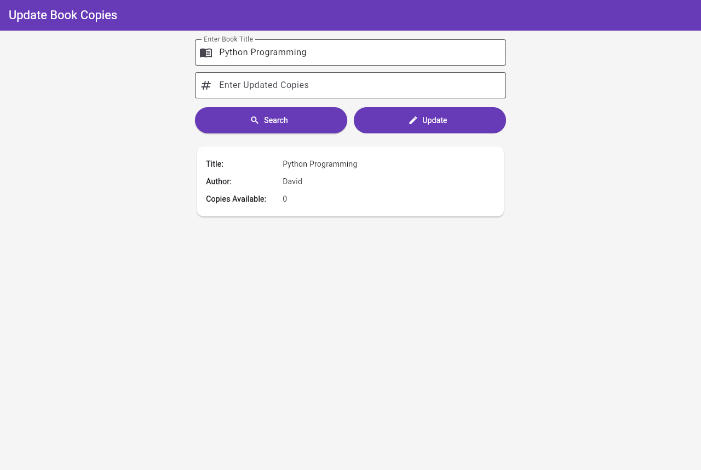
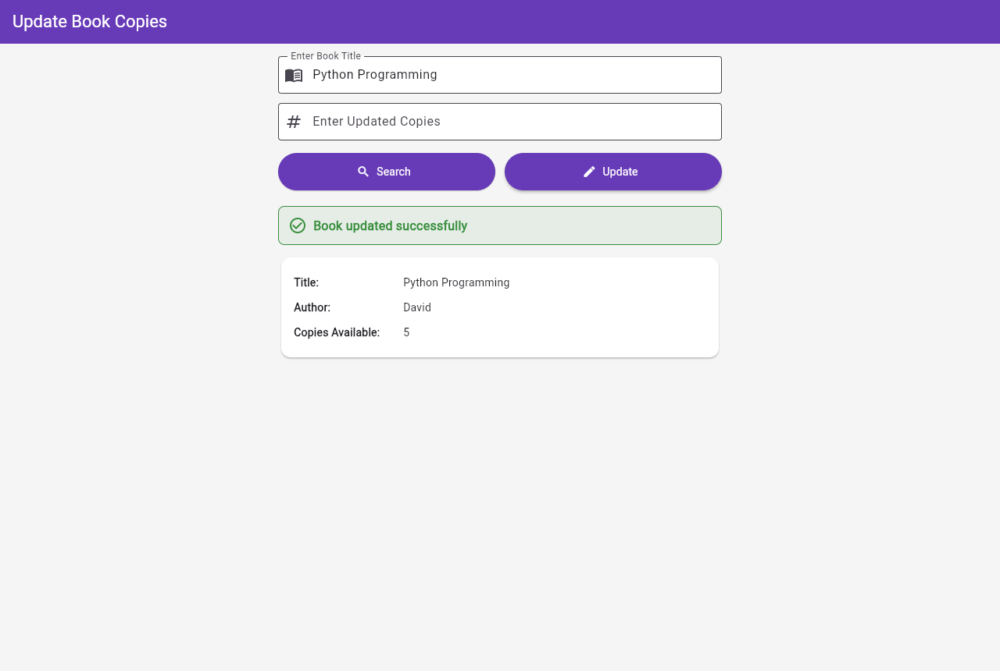
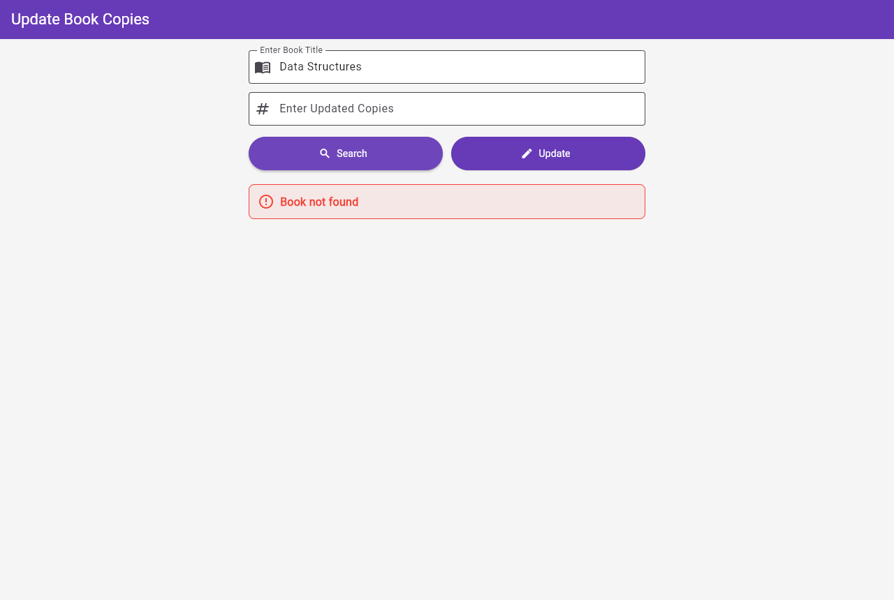
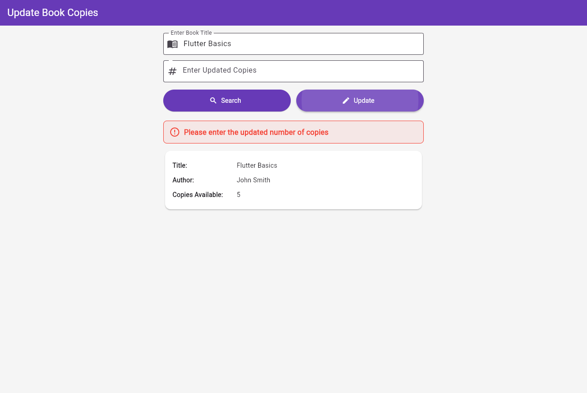
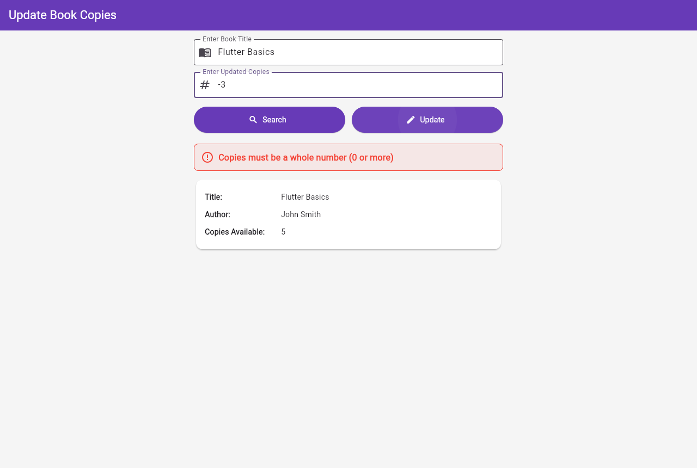

# Experiment 9 – Update Book Copies using Google Firestore

**Update Book Copies using Google Firestore** (Question 2 – Even Regnos, URK23CS7070)

## Aim

Develop a Flutter application that searches a book in Google Firestore by title
and updates the number of copies available in the existing document.

## Technology Stack

| Layer    | Technology                                  |
|----------|---------------------------------------------|
| Frontend | Flutter (Dart)                              |
| Backend  | Google Cloud Firestore (Firebase)           |
| IDE      | Visual Studio Code                          |
| Platform | Web (Chrome) – Android configured as well   |

Reuses the same Firebase project as Experiments 7 and 8 (`flutterexperiment7-yb26`).

## Features

- AppBar titled **Update Book Copies**, bordered `TextField`s for the book title and the
  updated number of copies, purple **Search** and **Update** buttons.
- **Search** fetches the `books` collection with `FirebaseFirestore.instance`, finds the
  matching title (case-insensitive, extra spaces ignored), shows **Title**, **Author**,
  **Copies Available** in a `Card`, and keeps the document's `DocumentReference`.
- **Update** validates the copies value (required, whole number ≥ 0) and calls
  `bookRef.update({'copies': n})` – only `copies` changes; title and author are untouched.
  `update()` fails on a missing document, so it can never create a new book.
- After updating, the document is read back with `bookRef.get()` and the card shows the
  new value immediately, with a green **Book updated successfully** message.
- **Book not found**, validation and Firebase errors are shown in red.
- Loading indicators on the buttons while searching / updating; both buttons are disabled
  while a request is running.
- The app never adds books; they are created manually in Firebase Console.
- Light background, responsive layout (max width 600 px, scrolls on small screens).

## Firestore Data Model

Collection: `books` (added manually in Firebase Console)

| Field    | Type   | Example        |
|----------|--------|----------------|
| `id`     | Auto ID / ISBN (document ID) | `sfrIeHEIAdS1B7PnEF16` |
| `title`  | string | Python Programming |
| `author` | string | David          |
| `copies` | number | 0              |

## Project Structure

```
lib/
  main.dart                 Firebase initialization + app entry
  update_book_screen.dart   Search + update UI and Firestore logic
  firebase_options.dart     (not committed – same config as Experiment 8)
test/
  widget_test.dart          Widget tests with FakeFirebaseFirestore
tool/
  e2e_chrome_test.py        End-to-end test in Chrome against real Firestore
screenshots/                Output screenshots
```

## Run

```bash
flutter pub get
flutter analyze
flutter test
flutter run -d chrome        # or: flutter run (Android emulator / device)
```

End-to-end test (after `flutter build web`, needs Python + Playwright):

```bash
python tool/e2e_chrome_test.py screenshots
```

## Test Cases

| # | Action                                        | Expected output                                   |
|---|-----------------------------------------------|---------------------------------------------------|
| 1 | Search `Python Programming`                   | David, Copies Available: 0                        |
| 2 | Enter `5`, Update                             | Book updated successfully (green)                 |
| 3 | –                                             | Card shows Copies Available: 5 immediately        |
| 4 | Search `Artificial Intelligence`, update to 7 | Copies Available: 7, Book updated successfully    |
| 5 | Search unknown title                          | Book not found (red)                              |
| 6 | Empty title / empty or invalid copies         | Validation message (red), nothing written         |

## Output Screenshots

| Screen | Python Programming found | Updated 0 → 5 |
|---|---|---|
|  |  |  |

| Artificial Intelligence | Updated 3 → 7 | Book not found |
|---|---|---|
|  |  |  |

| Empty title | Empty copies | Invalid copies | Mobile layout |
|---|---|---|---|
|  |  |  |  |

## Result

The Flutter application successfully searches a book in Google Firestore, updates only
its `copies` field in the existing document and displays the updated details immediately.
